<a href="https://sufian-choudhury.vercel.app"></a>



<a href="https://github.com/sufianabcy/HealthCore-backend"></a>
<a href="https://github.com/sufianabcy/behavioral-detection-engine"></a>
<a href="https://www.codechef.com/users/kl2400031520"></a>

<a href="https://github.com/sufianabcy/HealthCore-backend"></a>
<a href="https://github.com/sufianabcy/behavioral-detection-engine"></a>
<a href="https://github.com/sufianabcy/DriftBound"></a>
<a href="https://github.com/sufianabcy/scheduler"></a>

<a href="https://linkedin.com/in/sufian0"></a>


<a href="https://sufian-choudhury.vercel.app">Portfolio</a> ·
<a href="https://linkedin.com/in/sufian0">LinkedIn</a> ·
<a href="https://www.codechef.com/users/kl2400031520">CodeChef</a> ·
<a href="mailto:contact.sufianchoudhury@gmail.com">Email</a> ·
<a href="https://github.com/sufianabcy?tab=repositories">All repositories</a>

